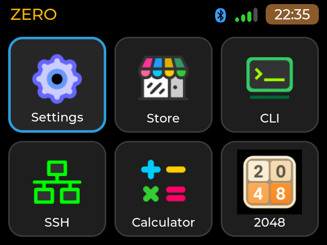
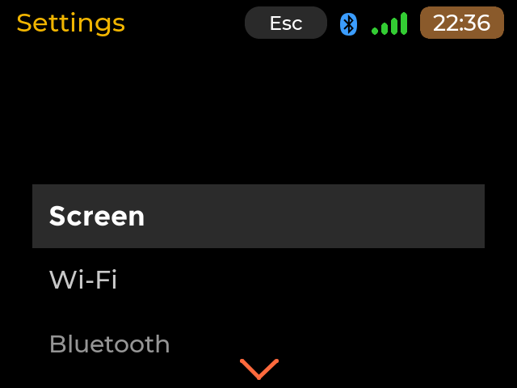
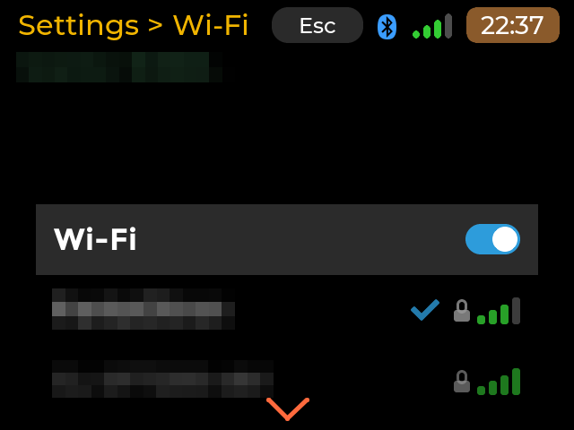
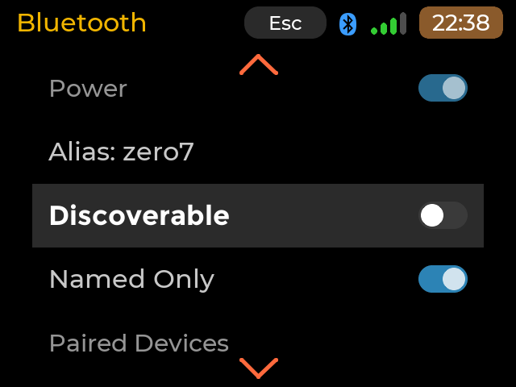
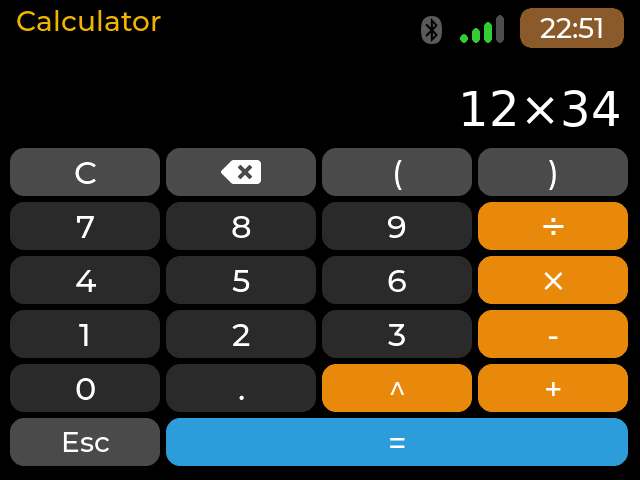
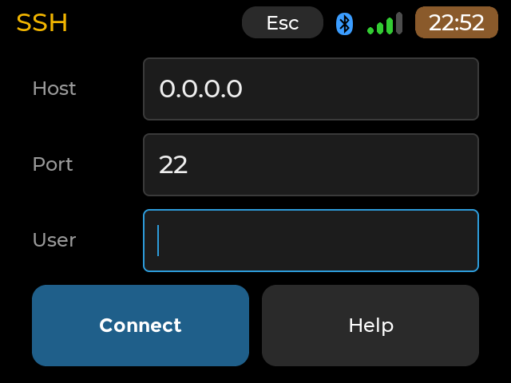
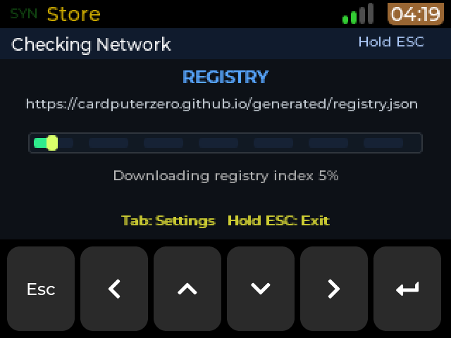

# CyberdeckZero Launcher

**A touch launcher for Raspberry Pi cyberdecks.**

<!-- branding-allow-begin: disclaimer -->
> **CyberdeckZero Launcher is an independent hobby project**, derived from the MIT-licensed CardputerZero launcher by
> M5Stack Technology CO LTD, and bundles M5Stack's CardputerZero Store unchanged. It is not affiliated with,
> sponsored or endorsed by M5Stack.
<!-- branding-allow-end -->

CyberdeckZero Launcher is a home grid, a native touch-friendly Settings and an app installer for small Raspberry Pi
machines with a touch screen and a keyboard. One code base adapts its layout to the screen; it runs on a Raspberry Pi
Zero 2W cyberdeck (Waveshare 2.8" DPI touch LCD, 640x480), a Raspberry Pi 3A+ with a Waveshare 4.3" DSI panel
(800x480) or a 3.5" SPI panel (480x320) and a HackBerry CM5 (720x720). It has a full-screen terminal, a Calculator, the Store, Wi-Fi / Bluetooth / time settings, a PWM
backlight, a fallback on-screen keyboard that shows only when no physical keyboard is present, a small
[app contract](docs/APP-CONTRACT.md) so apps can adapt to the screen too, and our own apps source
([cyberdeck-zero-apps](https://github.com/OSRdesign/cyberdeck-zero-apps)) offered by default in Settings > Apps.

## How it started

<!-- branding-allow-begin: the author's story (inspiration) -->
I ordered two **CardputerZero** from M5Stack, but they have not been delivered yet and I could not wait any
longer to try the software. Sitting on my desk was the cyberdeck I built from this Reddit post:
[My first cyberdeck build](https://www.reddit.com/r/cyberDeck/comments/1tng497/my_first_cyberdeck_build/)
(a Raspberry Pi Zero 2W, a Waveshare 2.8" DPI touch LCD and a Bluetooth keyboard). So I opened Claude Code
and asked it to adapt the CardputerZero launcher to that machine. The result ran on a Pi Zero 2W, with touch, a 2x
upscaled window for the stock 320x170 apps, and has since grown into the launcher described above.

> **This is a hobby project and a derivative work.** Almost all of the code is the work of the CardputerZero
> and M5Stack teams and of the open-source projects listed in the credits below. My changes are the Raspberry Pi
> port, the responsive shell and the native Settings (see [`projects/APPLaunch/pizero2w/`](projects/APPLaunch/pizero2w/)),
> written together with Claude.
<!-- branding-allow-end -->

## Screenshots

Captured from the deck's own framebuffer (640x480). Network names are pixelated.

| Home grid | Settings |
| --- | --- |
|  |  |
| **Settings > Wi-Fi** | **Settings > Bluetooth** |
|  |  |
| **Calculator** | **SSH** |
|  |  |

The Store (M5Stack's CardputerZero Store, unchanged, upscaled 2x) while it syncs its catalog:

## Inspiration and credits

<!-- branding-allow-begin: credits -->
This project exists only because of other people's generous work. Huge thanks to all of them, from a hobbyist
who learns a lot from open source:

- **CardputerZero launcher** (the original this is based on) and its apps — the
  [CardputerZero](https://github.com/CardputerZero) organisation:
  [launcher](https://github.com/CardputerZero/launcher), [Store](https://github.com/CardputerZero/Store),
  [Calculator](https://github.com/CardputerZero/Calculator), [CameraApp](https://github.com/CardputerZero/CameraApp),
  [Keyboard-Guide](https://github.com/CardputerZero/Keyboard-Guide)
- **M5Stack** — [M5Stack_Linux_Libs](https://github.com/m5stack/M5Stack_Linux_Libs) SDK and the CardputerZero hardware
- **LVGL** — [lvgl/lvgl](https://github.com/lvgl/lvgl), the graphics library behind every screen
- **SCons** — [SCons/scons](https://github.com/SCons/scons), the build system
- **The cyberdeck that started it** — the author of the Reddit build post linked above
- **Waveshare** — the 2.8" DPI LCD and its overlays ([Waveshare wiki](https://www.waveshare.com/wiki/2.8inch_DPI_LCD))
- **MeshCore** — [meshcore-dev/MeshCore](https://github.com/meshcore-dev/MeshCore) (firmware and protocol, MIT) and [meshcore_py](https://github.com/meshcore-dev/meshcore_py) (MIT), the base of the Mesh Hop app in the apps repository; [MeshCore Open](https://github.com/zjs81/meshcore-open) and meshcore-gui (MIT), wadamesh and Meshy (GPL) were feature references only, no code copied from the GPL ones
- **Raspberry Pi** — [raspberrypi/linux](https://github.com/raspberrypi/linux) and [raspberrypi/firmware](https://github.com/raspberrypi/firmware)
- **EXKnight M4** Bluetooth keyboard, whose layout I mapped
- Libraries bundled by the launcher (full list and licences in
  [`docs/OPEN_SOURCE_COMPONENTS.md`](docs/OPEN_SOURCE_COMPONENTS.md) and [`LICENSES/`](LICENSES/)):
  [nlohmann/json](https://github.com/nlohmann/json), [cJSON](https://github.com/DaveGamble/cJSON),
  [fmt](https://github.com/fmtlib/fmt), [spdlog](https://github.com/gabime/spdlog),
  [cpp-httplib](https://github.com/yhirose/cpp-httplib), [libhv](https://github.com/ithewei/libhv),
  [eventpp](https://github.com/wqking/eventpp), [tinyalsa](https://github.com/tinyalsa/tinyalsa),
  [miniaudio](https://github.com/mackron/miniaudio), [RadioLib](https://github.com/jgromes/RadioLib),
  [SimpleBLE](https://github.com/simpleble/simpleble), [C-Thread-Pool](https://github.com/Pithikos/C-Thread-Pool)
- **System pieces used on the Pi**: [libinput](https://gitlab.freedesktop.org/libinput/libinput),
  [libxkbcommon](https://github.com/xkbcommon/libxkbcommon), [FreeType](https://gitlab.freedesktop.org/freetype/freetype),
  [NetworkManager](https://gitlab.freedesktop.org/NetworkManager/NetworkManager), [BlueZ](https://github.com/bluez/bluez),
  [systemd](https://github.com/systemd/systemd), [polkit](https://github.com/polkit-org/polkit)
- **Claude Code** by [Anthropic](https://github.com/anthropics/claude-code), which did the porting work with me

Thank you all for your contribution to open source, and for making it possible for hobbyists like me to build
and tinker with things like this.
<!-- branding-allow-end -->

## Your own apps

**Settings > Apps** installs and removes apps from any public GitHub repository you add as a source
(`owner/repo`), so you can sideload your own. Our apps (LAN Scan, Mesh Hop, Net Toolbox, Serial Console, System
Monitor, viz1090, Wi-Fi Survey) are in [cyberdeck-zero-apps](https://github.com/OSRdesign/cyberdeck-zero-apps),
which is also the template to host your own: see [`docs/HOSTING-APPS.md`](docs/HOSTING-APPS.md).

Settings > Apps shows the installed and the available version of each app (an update is marked in yellow, for
example `0.1.2>0.1.3`), with **Update** for one app and **Update all** when several have one. An upgraded app
keeps its tile where it was on the home grid (the order is stored in `~/.config/cardputerzero/config.json` as
`app_order`); a new app goes last. A sync shows each source live (`waiting`, `syncing...`, `done` or a red
`failed` with the reason), and installs, updates and removals show the step and the seconds taken, then a plain
success or failure message. With a keyboard: `U` update all, `S` sync, `A` add a source, `D` remove a source,
plus the arrows, Enter, Esc and Del. The details are in [`docs/HOSTING-APPS.md`](docs/HOSTING-APPS.md).

## What is in this repository

<!-- branding-allow-begin: derivation statement -->
- The launcher tree inherited from the CardputerZero launcher, with the Raspberry Pi port on top. The upstream
  project's README and guides are kept, unedited, in [`docs/upstream/`](docs/upstream/)
  ([README](docs/upstream/UPSTREAM_README.md), [中文](docs/upstream/README_ZH.md), [日本語](docs/upstream/README_JA.md)).
<!-- branding-allow-end -->
- **[`projects/APPLaunch/pizero2w/`](projects/APPLaunch/pizero2w/README.md)**: everything specific to the Raspberry
  Pi boards: what the port adds, how to build the bundle (`build.sh`), how to install it (`install.sh`), the panel
  configuration, udev / PolicyKit rules, and the known limits.
- [`NAMING.md`](NAMING.md): the product names, and the technical names inherited from upstream that stay
  (`APPLaunch`, `APPLAUNCH_*`, `cp0_`, the config and Store folders) and why.

## Quick start

1. Set up the Pi and the panel as described in the [Pi port README](projects/APPLaunch/pizero2w/README.md).
2. Download `cyberdeckzero-launcher-<version>-arm64.tar.gz` from the
   [releases](https://github.com/OSRdesign/cyberdeck-zero-launcher/releases) (the first release after the rename
   also carries the same file as `pizero2w-bundle.tar.gz`, the older name), or build it on Linux x86_64 or WSL with
   `projects/APPLaunch/pizero2w/build.sh --with-store`.
3. Copy it to the Pi, unpack it and run `sudo ./install.sh` in the unpacked folder.

## Licence

<!-- branding-allow-begin: licence notice -->
MIT, as the original ([`LICENSE`](LICENSE), copyright M5Stack Technology CO LTD); third-party components keep
their own licences ([`LICENSES/`](LICENSES/), [`docs/OPEN_SOURCE_COMPONENTS.md`](docs/OPEN_SOURCE_COMPONENTS.md)).
CyberdeckZero Launcher is not affiliated with or endorsed by M5Stack, CardputerZero, Waveshare or the Raspberry Pi
Foundation.

The compiled launcher program is MIT as well: the Settings menu tree, which used the GPL-3 `tree.hh` until 2026-10-13,
is now our own code (`ext_components/cp0_lvgl/include/cp0_tree.hpp`), so the GPL no longer applies to the program.
<!-- branding-allow-end -->
