# The PDA profile

Since v0.8.8 the launcher can run upright, as a small handheld with a pen: a portrait screen, a handwriting band at the
bottom for text, and a single-stroke handwriting alphabet you can train on your own hand. This page says what it is,
how to turn it on and how to write with it. The pictures are renders made by the launcher's render harness at 480x800,
not photographs of the board.

## What it is

- A **profile you choose**, never detected. The landscape profile of the same board is unchanged.
- A portrait panel of 480x800 (the Raspberry Pi 3A+ with the Waveshare 4.3" DSI screen, turned) or 480x640 (3.5 to 4
  inch). The home grid has three columns, the status strip is drawn smaller and page titles show only the last part of
  a path ("Screen", not "Settings > Screen").
- Apps that declare a portrait size are shown as they are. A landscape app that fits is run turned by a quarter turn;
  compat apps and apps that do not fit are hidden.
- The app switcher is on, as on every panel whose short side is 480 px or more.

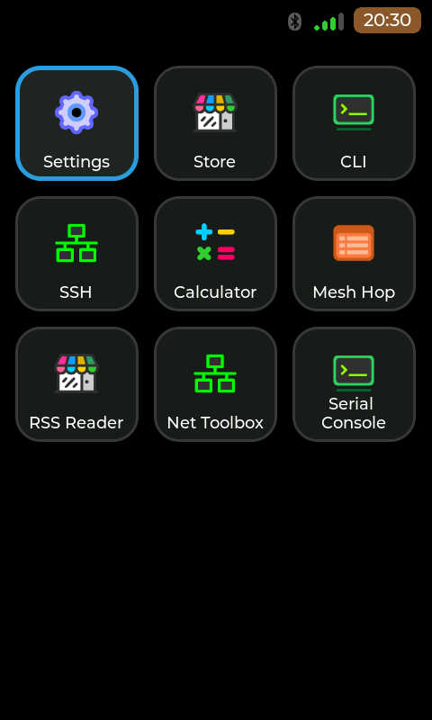

## Install

On the Pi 3A+, add the board flag to the install command, and pass the same flag on every update:

```
sudo ./install.sh --board pi3a-wsdsi43-portrait
```

Then reboot. The other flags (`--keyboard-name`, and so on) are as in the [README](../README.md#quick-start).

## PDA mode in Settings

Settings > Screen > **PDA mode** turns the profile on or off on any board whose screen has room for it: Off, **On rotate
left** or **On rotate right**. Rotate left means the device is turned a quarter to the left from its landscape position
(the landscape panel's right edge at the top, what the install profile above does); rotate right the other way round.
Picking another value asks first: the launcher restarts and open apps are closed. The choice is kept in the user's
settings (`~/.config/cardputerzero/config.json`, key `pda_mode`: 0 Off, 1 left, 2 right), so a later `install.sh`
without the portrait flag does not undo it. While nothing is chosen, the board profile decides (the portrait profile:
On rotate left).

The row is there when the short side of the screen is 480 px or more, the screen is not square and the band leaves at
least 400 px above it in portrait: the Pi 3A+ and Pi 4 B DSI panels, the FZ-M1 tablet (800x1280 in portrait), a
HyperPixel 4. The deck, the 3.5" Luckfox panel and the HackBerry's square 720x720 screen do not have it. Landscape PDA
is not offered.

| Screen > PDA mode | The question |
| --- | --- |
| 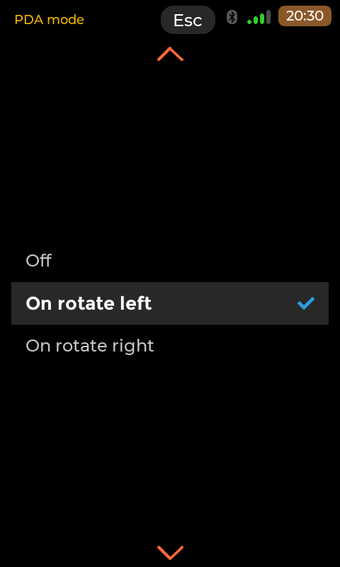 | 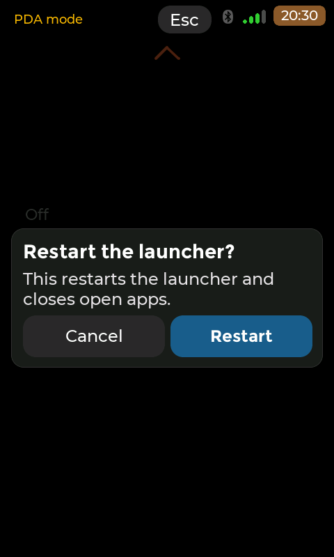 |

On the right side, a landscape app run turned is drawn upside down from the panel's own landscape (rotation 180): turn
the device clockwise from portrait to read it, as on the left side.

## The band and the key strip

Where a text field asks for input, a band comes up at the bottom of the screen: a **key strip** over two writing boxes,
**abc** (letters) on the left and **123** (digits) on the right. Strokes drawn in a box are recognised and typed as
keys. Touches in the band never reach the app, and when the band is hidden the page gets the whole panel. A physical
keyboard hides the band, as it hides the on-screen keyboard.

The key strip has, from left to right: **Keyb**, **Tab**, **Ctrl**, **Alt**, the four arrows and **Enter**. Ctrl and
Alt are armed by a tap and apply to the next key (in the picture, Ctrl is armed in the terminal, so a letter written
next is typed as Ctrl plus that letter). **Keyb** puts the standard on-screen keyboard in the band's place; the
keyboard's close cross brings the band back.

| Text field and band | Pen ink | Terminal, Ctrl armed | Keyboard with its cross |
| --- | --- | --- | --- |
| 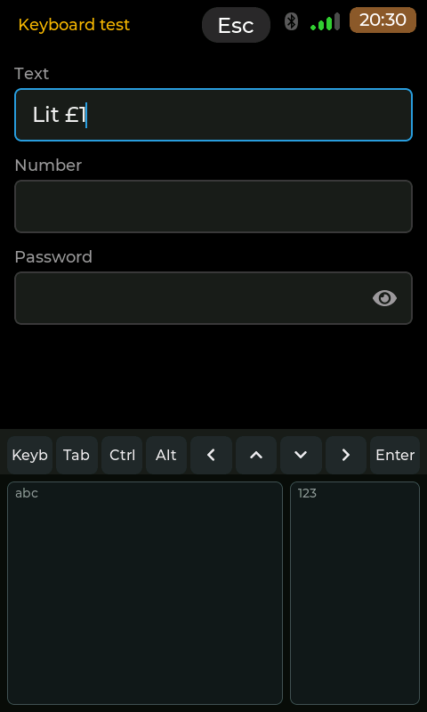 | 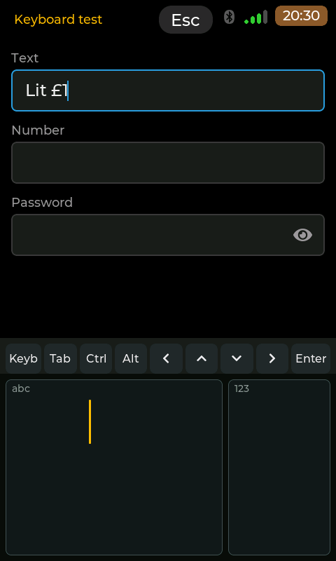 | 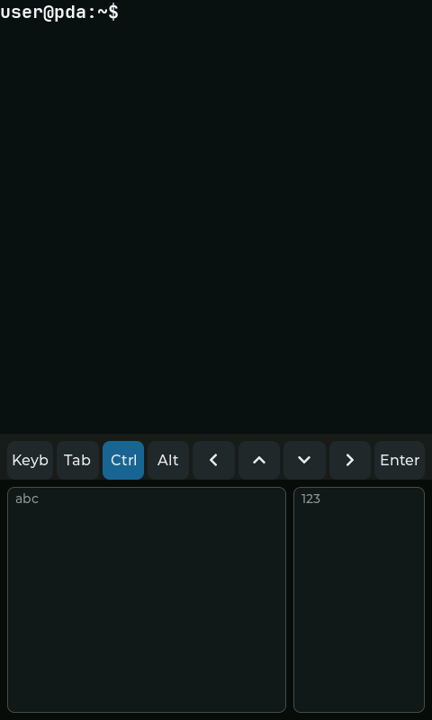 | 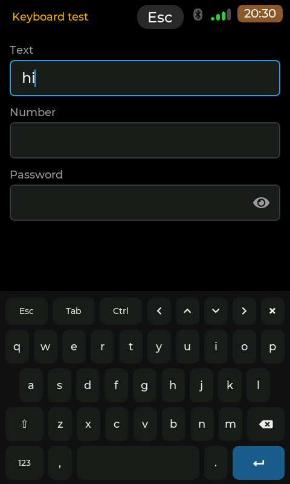 |

## The keyboard setting

Settings > System > On-screen keyboard has three values:

- **Auto**: the fallback on-screen keyboard shows only when no physical keyboard is present.
- **On**: the on-screen keyboard shows on text fields.
- **Handwriting + keyboard**: the band shows; Keyb switches to the standard keyboard. This is the default on the PDA
  profile, and the value on that page's picture.

Off no longer exists. A stored Off reads as Auto.

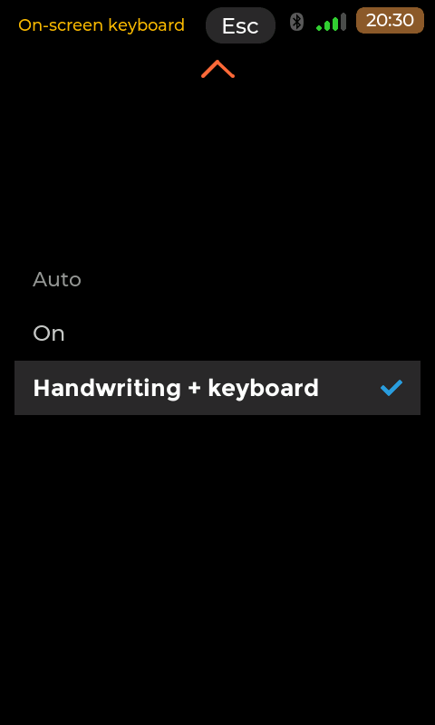

## Apps with the band

Since v0.8.11 an app can have the band too. Set Settings > System > On-screen keyboard to **Handwriting + keyboard** (the
default on the PDA profile). An app that declares a portrait size (`X-Portrait`) and is shown upright then draws the
band itself: when one of its text fields asks for input, the band comes up where the on-screen keyboard would, the text
above keeps its rows, and the app's field stays visible. The key strip acts as the keyboard's keys do (Enter sends the
line in the terminal, Ctrl armed then a written letter is Ctrl plus that letter), **Keyb** swaps in the standard
keyboard and its cross brings the band back, and a physical keyboard hides the band. With the setting on Auto or On the
app shows the standard keyboard, as before.

Serial Console is the first app to have it (version 0.6.0). Apps built with an older toolkit keep the on-screen
keyboard, and so do landscape apps run turned. Nothing is set in the app's `.desktop` file: the launcher tells the app
it runs upright, and the app reads your trained glyphs when it starts.

The renders below are the Serial Console in its demonstration world, made by the apps repo's headless harness (scene
`portrait-band`) with the shipped strokes table: "help" has been written into the line field. They are not photographs
of a board.

| 480x800, band | 800x1280, band | 480x800, Keyb (standard keyboard) |
| --- | --- | --- |
| 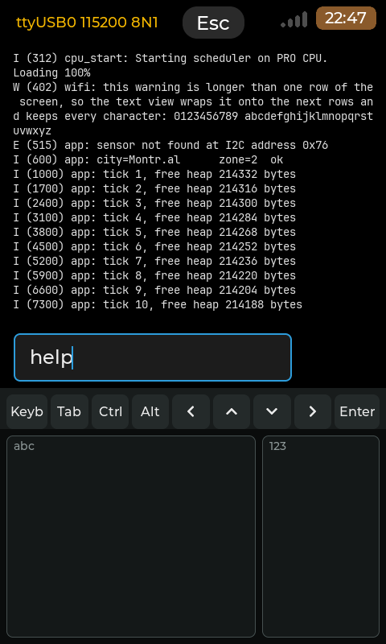 | 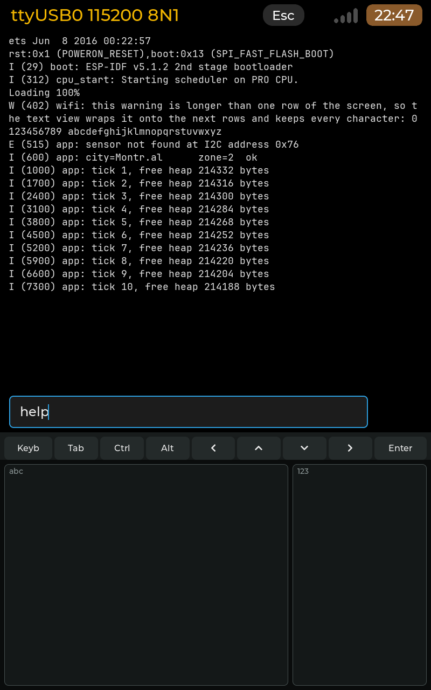 | 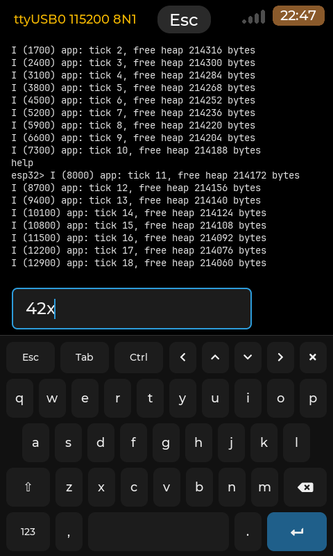 |

## Writing with strokes

The alphabet is a single-stroke handwriting alphabet: each letter, digit and gesture is one stroke of the pen. The
shipped table is `share/strokes/glyphs.txt` in the bundle (installed as `/usr/share/APPLaunch/strokes/glyphs.txt`) and
is read-only. A glyph's strokes were traced by hand from a public reference chart into our own format; the table's
header says how.

- **Letters** are typed in lower case, written in the **abc** box. **Digits** are written in the **123** box.
- **A capital**: write an up stroke (bottom to top) before the letter. It applies to that one letter.
- **Caps lock**: two up strokes. A third turns it off.
- **Space**: a stroke from left to right.
- **Backspace**: a stroke from right to left.
- **Enter**: a stroke from top right down to bottom left.
- **Punctuation**: a tap puts the box in punctuation mode, then write the mark. The mode stays on after a refused
  stroke; a backspace stroke leaves it without deleting anything. A tap inside it is the period.
- **Extended characters** (rarer symbols, and X, which takes two strokes): start with a stroke from top left down to
  bottom right, then the glyph.
- **Accents** are written before the letter, as a dead accent that composes with the next letter.

The table is the reference for exact shapes; a stroke is judged on its shape and on where it starts, not on its size.

## Strokes training

Settings > System > Strokes training (PDA profile only) teaches the recogniser your own hand. The page keeps the band
shown and takes its strokes without typing. It shows the glyph to write with the chart stroke as a guide, and judges
four attempts per glyph: recognised, refused, or read as another glyph. Your attempts become personal templates that
the recogniser loads at once.

The **Pick** button opens a glyph picker: grey glyphs are not trained, green are trained, amber are hard (under 75 %).
The page also has Back, Skip, Redo, Reset all (it asks first) and Finish, which re-tests each trained glyph and then
shows a summary. It resumes where it stopped.

| Training | Glyph picker |
| --- | --- |
| 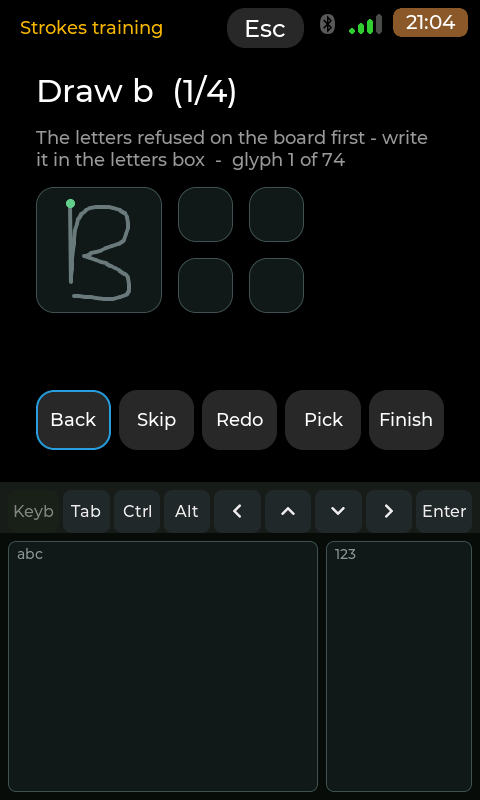 | 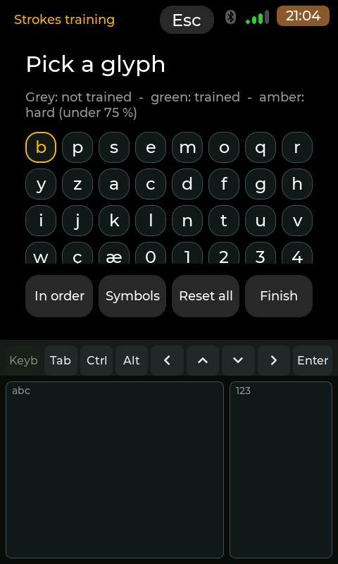 |

Two files are kept in `~/.config/applaunch/`:

- `strokes-user.txt`: your personal templates, in the table's format, loaded after the shipped table. You can add
  variants by hand; lines you write are kept.
- `strokes-training.txt`: every attempt, appended, for tuning. The PC tool `strokes-log` in `tools/strokes/` reads it.

## Large screens: the tablet

The profile was made for a 4.3" panel, but the setting is not tied to it. Since v0.8.9 any panel whose short side is at
least 480 px, that is not square and leaves room for the band offers Settings > Screen > PDA mode: the 7-inch FZ-M1
tablet, a 1024x600 panel, the 800x480 DSI panels (the Pi 3A+ and Pi 4 B screens). Square panels (the HackBerry's
720x720) and the deck (no board profile with a screen size) do not have the row; a 3.5" 640x480 panel (480x640 in portrait) does, once its board profile gives the size. There is no landscape PDA.

The tablet's panel is 1280x800 (about 152 x 94 mm) and is landscape in its stock position. **On rotate left** holds the
tablet a quarter turn to the left from that position: the launcher then draws a 800x1280 portrait screen, the panel's
right edge at the top. **On rotate right** is the other quarter turn; the picture is then the other way up, and a landscape
app run turned is drawn upside down from the panel's own landscape. The three values and the restart were tried on the
tablet; rotate right has not been tried on a DSI board.

On the tablet nothing has to be edited. Open Settings > Screen > PDA mode, pick On rotate left or On rotate right,
and answer the question: the launcher restarts (open apps are closed) and comes back in portrait. The choice is kept in
the user's settings, so it survives updates; pick Off to go back. `board.conf` and the install flags do not need to
change (the board profile is only what decides while nothing has been chosen).

The band is sized by the screen's height, the same on every panel, and the tablet needs no change to it: on the 800x1280
screen the two writing boxes are 427 px high (one third), the key strip is 51 px above them, and the page keeps the
upper 802 px, a little under two thirds. Home grid, Settings and terminal use the room as they use it elsewhere; the
status strip and the page titles are the ones of a wide portrait screen (a whole path such as "System > Keyboard
test", where the 480 px screens show the last part only).

These four pictures are renders made by the launcher's render harness at 800x1280 (scenes `pda_tablet`,
`pda_tablet_terminal` and `pda_mode` in `projects/APPLaunch/tests/render/`), with the tablet's board name and panel
size. They are not photographs of the tablet.

| Home grid | Band under a text field | Terminal, Ctrl armed | Screen > PDA mode |
| --- | --- | --- | --- |
| 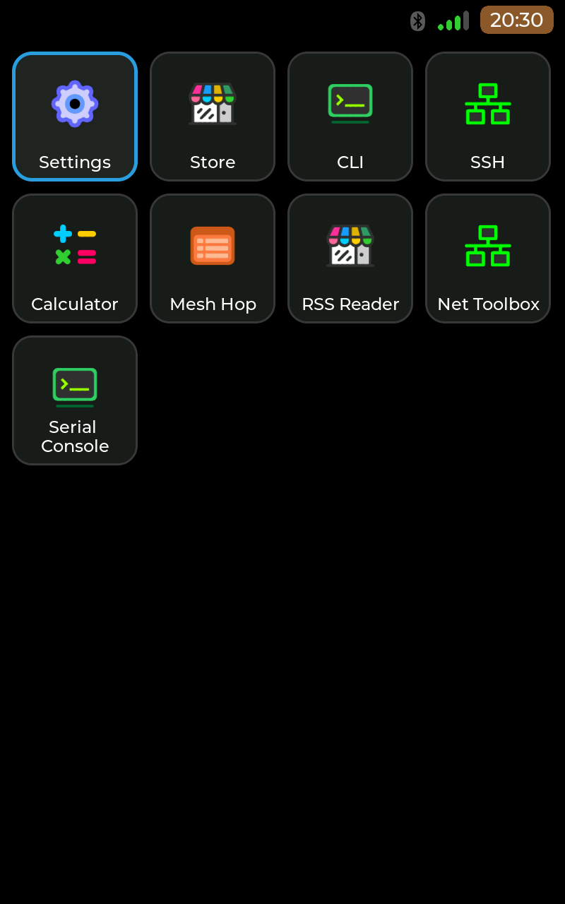 | 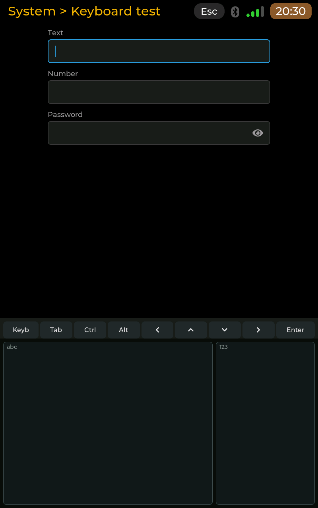 | 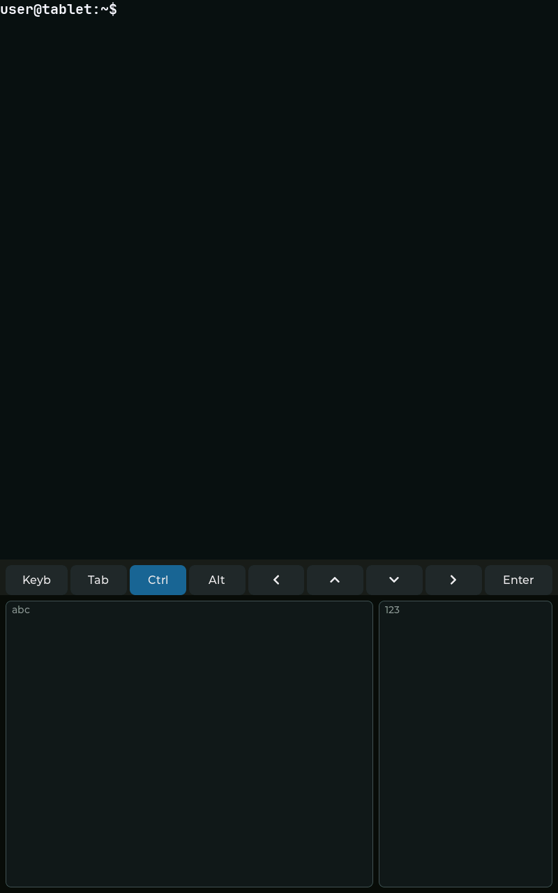 | 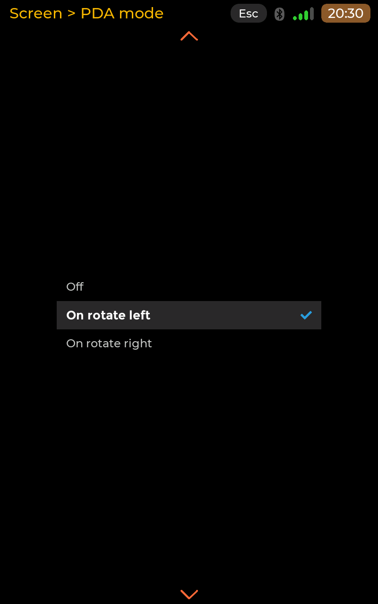 |
| Four columns, nine tiles, no band: the grid has the whole screen | Keyboard test: three fields above, the key strip and the two boxes below | The terminal gives its rows up to the band; Ctrl is lit | Off, On rotate left (checked), On rotate right |

**Pens on the tablet.** The tablet's touch controller reports fingers only (one USB touchscreen device, no pen or stylus
reports), so the band takes whatever the panel detects as a touch. A finger and a capacitive stylus work well. The official
Panasonic stylus is not detected, probably because it needs Panasonic's own driver, which Linux does not have.

## Limits

- Accuracy has only been measured on synthetic strokes made from the table's own templates (99.5 % correct on them,
  about 82 % under harsh noise). On the first board test 11 of 26 letters were refused before the training page
  existed. A capture session with a real stylus is planned.
- The physical size of the Pi 4 B's Freenove panel is a guess, to be checked with a ruler.
- Keys from the band do not reach compat apps (they are hidden on portrait).
- An app shown upright in portrait (it declares `X-Portrait`) draws the band itself, by the same setting, once it is
  built with a launcher toolkit that has it (v0.8.11, report 044; Serial Console so far, see "Apps with the band"). The
  app reads your trained glyphs when it starts: a glyph trained while it is open counts there after its next start.
  Apps shown turned, and apps built with an older toolkit, keep the standard keyboard.
- A turned app at rotation 180 (PDA mode On rotate right) has not run on a board.
- PDA mode's restart (exit status 76, restarted by both launcher units) has not run on a board yet.
